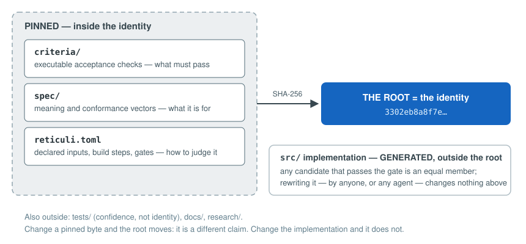

# reticuli

Reticuli identifies software by a SHA-256 hash (the **root**) computed over
its acceptance criteria, specification, and build recipe. The
implementation is excluded from the hash. Any implementation that passes
the acceptance gate is a member of the class the root names.

This inverts the usual trust model. The artifact is not the unit of trust;
the obligations are. Consequences:

- An implementation can be regenerated by an independent producer, from
  the pinned inputs alone, without changing identity.
- Verification does not require trusting the author, the transport, or the
  producer. Verdicts are re-earned, not inherited.
- Changing any pinned byte changes the root. It is a different claim and
  is treated as one.

## Problem statement

Two cases, one failure mode:

1. Software is received (a dependency, a release). The recipient can check
   that the bytes match a hash. Nothing else is checkable without trusting
   the sender's test selection and execution.
2. Software is written by a coding agent. Output volume exceeds review
   capacity. "It passed the tests" is unverifiable if the agent could
   influence the tests, the environment, or the reported result.

Reticuli's mechanism for both: pin the obligations, hash them into the
identity, and make every verdict reproducible by a party that trusts no
one.

Because the implementation is outside the identity, it is checkable by
regeneration: a producer is placed in an isolated directory containing only
the pinned inputs and regrows the implementation from the criteria. If the
result passes the same gates, the criteria carry the software. If not, the
diff between what was built and what the tests demand locates the
under-specification. The complete validity test uses three machines; see
[the three-machine test](process.md#the-three-machine-test).

## Documentation structure

Three tracks, ordered by dependency:

| Use case | Entry point |
|---|---|
| Receive or ship software; verify without trusting the sender | [Track 1: receive/ship](track-shipping.md) |
| Run coding agents whose output is verified, not reviewed | [Track 2: agent reproducibility](track-agents.md) |
| Reconstruct implementations and evolve the specification from the results | [Track 3: specification](track-specification.md) |

Shared references: [the process](process.md) (lifecycle and the
three-machine test), [glossary](glossary.md),
[the annotated implementation](book/index.md) (all 68 modules, source with
commentary, generated from the tree).

## Reading order for the core

1. `reticuli._kernel.core` — vocabularies: verdict, cost, confinement.
2. `reticuli._kernel.recipe` — declared inputs, steps, gates.
3. `reticuli._kernel.identity` — the root computation.
4. `reticuli._kernel.build` — rooms, input materialization, environment
   scrub, rebuild.
5. `reticuli._kernel.run`, `attest` — execution, ledger, the record
   format.
6. `reticuli._kernel.crosscheck` — the three-machine test.
7. Surface (`reticuli.kernel`, CLI); then `zeta.lib.probe` and
   `zeta.lib.split`.

The pinned inputs themselves (`criteria/`, `spec/`, zeta's criteria) are
not rendered in this site. They are the identity; read the bytes in the
repository.
