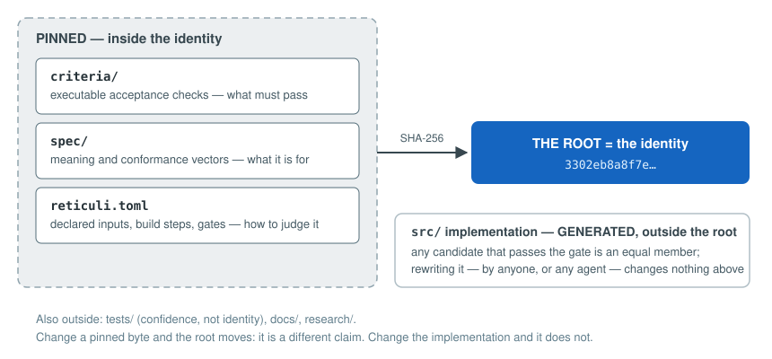
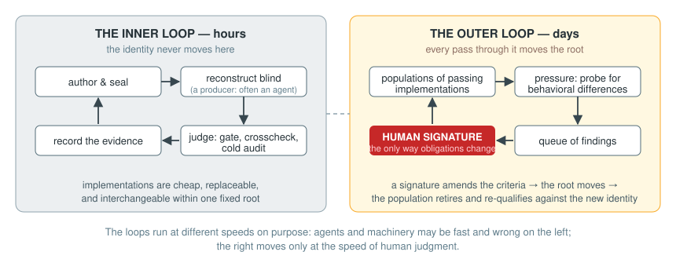
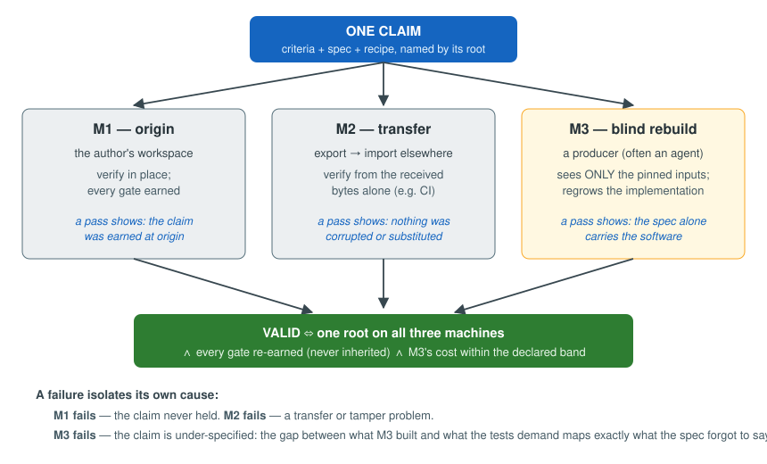

# The process

## Design

Two situations share one failure mode:

1. Software is received. The recipient can check that the bytes match a
   hash, but nothing else is checkable without trusting the sender's choice
   of tests and the way they were run.
2. Software is written by a coding agent. The volume of output exceeds
   anyone's review capacity, and "it passed the tests" cannot be checked if
   the agent could influence the tests, the environment, or the reported
   result.

Reticuli handles both the same way. It pins the obligations, hashes them
into the identity, and makes every verdict reproducible by a party that
trusts no one. The artifact is not the unit of trust; the obligations are.

Because the implementation sits outside the identity, it can be checked by
regenerating it. A producer works in an isolated directory holding only the
pinned inputs and regrows the implementation from the criteria. If the
result passes the same gates, the criteria carry the software. If it does
not, the difference between what was built and what the tests demand shows
where the specification is thin.

## Lifecycle

A claim passes through six stages: author, seal, reconstruct, judge,
record, and evolve. The first five hold the identity fixed. The sixth is
the only way it moves.

## 1. Author

A claim directory contains:

| Material | Standing | Contents |
|---|---|---|
| `criteria/` | pinned | executable acceptance checks |
| `spec/` | pinned | specification prose and conformance vectors |
| `reticuli.toml` | pinned | declared inputs, build steps, gates |
| implementation | generated | satisfies the above; defines nothing |

`ret init` creates a workspace, `ret run` records observed commands, and
`ret pack` writes the recipe.

The rule for deciding where something goes is whether it has to bind a
future implementer. If it does, it belongs in the criteria or the
specification. If it merely helped the current implementer, it stays out.

## 2. Seal

The root is a SHA-256 over the pinned material, which gives it two
properties. Rewriting the implementation does not change the root, and
changing any pinned byte does.

`ret verify` recomputes the root and compares it. It takes seconds and runs
in CI on every push.

## 3. Reconstruct

`ret rebuild` materializes the claim into a room, which is a directory
containing only the declared inputs. The process environment is scrubbed,
so credentials and model selection reach the producer only if the operator
passes them explicitly. A producer is any program, though in practice it is
usually a coding agent. It may read the room, write candidates, and run the
gate as often as it likes, and it cannot affect any of the judgment stages
below.

Producer guidance is excluded from the root and from acceptance. A rebuild
that needs the hint in order to pass has measured the hint rather than the
criteria.

## 4. Judge: the three-machine test {#the-three-machine-test}

Validity decomposes into three questions, answered on three machines:

| Machine | Procedure | A pass establishes |
|---|---|---|
| M1 | verify **and audit** in place at origin | the claim was earned where it was made |
| M2 | export, import elsewhere, verify from received bytes | transfer integrity; no corruption or substitution |
| M3 | producer sees only pinned inputs; regrows the implementation; gates re-run | the specification alone carries the software |

A claim is valid when all three machines report one root, every gate is
re-earned, and M3's measured cost falls within the declared band around
M1's. The cost band is there so that "reproducible" cannot be satisfied by
a reproduction nobody could afford to run. Where the claim declares a
mutation floor, M3 re-earns that as well.

Which machine fails tells you what went wrong. A failure at M1 means the
claim never held. A failure at M2 is a transfer or tamper problem rather
than a problem with the software. A failure at M3 means the claim is
under-specified, and the difference between M3's output and what the tests
demand locates the missing specification, which is the input to stage 6.

A claim that reached you **without its implementation** has no M1 leg
available, because M1 is audited rather than merely verified and a gate with
nothing to judge cannot pass. That is the ordinary condition of a blind
export. What you can do is rebuild twice, copy one rebuild byte-for-byte, and
crosscheck the three. Be clear about what that buys: agreement among
independent reconstructions, not agreement with the origin, since the origin's
implementation never reached you.

Make the copy yourself, with `cp -a`, and pass three directories. Do not use
the two-directory form here: it materializes the byte-copy leg through export
and import, export does not preserve the executable bit, and the leg then
fails its audit for any claim whose output must be executable — so the
crosscheck rejects however sound the rebuild was
([how do I…?](how-do-i.md#regrow-something)).

Three commands map onto this, in increasing order of strength and cost.
`ret verify` compares roots and nothing more. `ret audit` re-earns every
gate cold in a fresh room from declared inputs, and is the verb a receiving
party reaches for. `ret crosscheck` runs the full three-machine test,
including the blind rebuild and any declared floors.

Verdicts are three-valued: `accept`, `reject`, and `incomplete`. A declared
condition that was not measured yields `incomplete`, and `incomplete` never
accepts. The three states are preserved end to end.

## 5. Record

`ret record` writes one machine's results — identity, gate verdicts,
environment, and measured cost — in a canonical byte format, so records
from different machines can be compared directly. `ret sign` attaches a
signature, and signed records are how verdicts travel between parties.

Cost units form a ladder: `usd > tokens > calls > seconds`. A comparison
uses the strongest unit both sides measured. A cost value must be a finite
non-negative number, and anything else is refused at validation.

## 6. Evolve

The first five stages hold obligations fixed. Changes to obligations go
through the pipeline below, which zeta implements
([internals](zeta.md)):

1. **Populations.** Sets of implementations that pass the current gate:
   independent reconstructions, the same bytes across declared host
   environments, and externally authored controls.
2. **Pressure.** Probes run against every member. A probe that partitions
   the population has found behavior the root does not determine.
3. **Classification.** Each finding is labeled by what adopting it would
   cost: a `contraction` where all members agree and pinning evicts no one,
   an `eviction` where members disagree and pinning excludes someone, or a
   `repair` where independent evidence contradicts all members.
4. **Queue.** Findings wait there, packaged so anyone can replay them.
5. **Signature.** A human reviews and signs. The signature amends pinned
   material, the root moves, and the standing population is retired.
   Membership is never inherited across a root move, so implementations
   re-qualify against the new identity.

No agent, instrument, or finding has any force without step 5.
