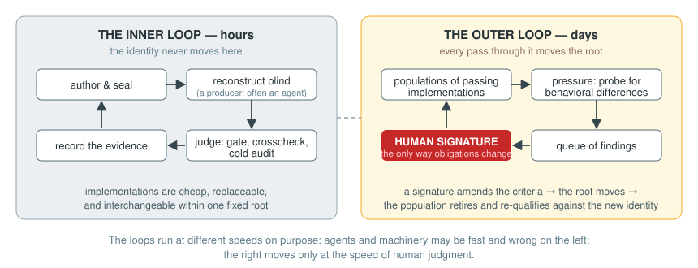
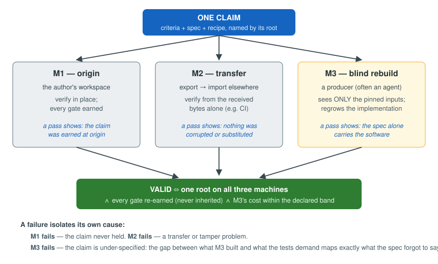

# The process

This page follows one piece of software through the full lifecycle: from
authoring, through independent reconstruction, to standing evidence — and
then through the slower loop by which its obligations are allowed to change.

## 1. Author: decide what the software must demonstrate

A claim is a directory holding three kinds of pinned material and one kind
of generated material:

- **Criteria** — executable acceptance checks. These are the strongest
  statement of what the software is, because they are the only statement a
  machine can hold it to.
- **Specification** — prose and conformance vectors: what the criteria
  mean, for a human and for the next implementer.
- **Recipe** (`reticuli.toml`) — the declared inputs, build steps, and
  gates: which command must succeed, and what it must produce.
- **Implementation** — declared as *generated*. It satisfies the above; it
  does not define anything.

`ret init` starts a workspace, `ret run` observes commands into it, and
`ret pack` writes the recipe. The discipline that matters at this stage is
placement: anything that should bind a future implementer goes in criteria
or specification; anything that merely helped this implementer stays out.

## 2. Seal: compute the identity

The root is a SHA-256 over the criteria, specification, and recipe — the
implementation is excluded by construction. Two consequences follow and
both are intended:

- Rewriting the implementation, by anyone or anything, does not change
  what the software *is*.
- Changing a criterion, a vector, or a declared input changes the root:
  it is a different claim about the world and is treated as one.

`ret verify` recomputes and compares the root. It is cheap and runs
everywhere, including in CI on every push.

## 3. Reconstruct: let an independent producer rebuild it blind

`ret rebuild` places the claim in a **room**: a directory containing only
the declared inputs, with the environment scrubbed so nothing undeclared —
credentials, ambient configuration, the original implementation — can leak
in. A **producer** is then invoked: any program that can write the
generated outputs. In practice the producer is usually a coding agent, and
the room is the whole of what it sees; it works from the criteria and
specification alone.

The producer is paid in attempts, not trust. It may read the room, write
its candidate, and run the gate as often as it likes; what it cannot do is
influence the judgment that follows.

## 4. Judge: the three-machine test {#the-three-machine-test}

The question "is this software what it claims to be?" decomposes into three
questions, each answered by a different machine, and the decomposition is
the heart of the method:

- **M1 — origin.** Verify in place, on the author's workspace. A pass
  shows the claim was earned where it was made.
- **M2 — transfer.** Export the claim, import it somewhere else, verify
  from the received bytes alone. A pass shows nothing was corrupted or
  substituted in transit. In this repository, CI plays M2 on every push,
  on a matrix of operating systems and interpreters.
- **M3 — blind rebuild.** A producer that sees only the pinned inputs —
  tests, fixtures, recipe; never the original implementation — regrows the
  generated outputs from scratch. A pass shows the strongest property of
  the three: *the specification alone carries the software.* An
  independent implementation landed in the same equivalence class.

The claim is **valid** exactly when one root holds across all three
machines, every gate is re-earned rather than inherited, and M3's measured
cost lands within the declared band of M1's (so "reproducible" cannot be
quietly satisfied by an infeasibly expensive reproduction).

The decomposition also works in reverse — a failure isolates its own
cause. If M1 fails, the claim never held. If M2 fails, the problem is
transfer or tampering, not the software. If M3 fails, the claim is
under-specified, and the diff between what M3 built and what the tests
demand maps exactly what the specification forgot to say — which is not a
breakdown of the method but its most valuable output, since it tells the
author precisely which sentence to write next.

The instruments, in increasing order of strength:

- **The gate** — the recipe's acceptance command, run in the room. Passing
  it is what makes a candidate implementation a member of the class.
- **Crosscheck** (`ret crosscheck`) — two or more independent realizations
  compared, with any declared quality floor (for example, a minimum
  mutation-kill rate) re-earned rather than copied forward.
- **Audit** (`ret audit`) — the verdict re-earned *cold*: a fresh room,
  only declared inputs materialized, every gate run again. An audit is what
  a stranger runs when they receive a claim and have no reason to believe
  anyone.

Every verdict is three-valued: **accepted**, **rejected**, or
**incomplete**. A declared condition that was not measured is incomplete,
and incomplete never counts as acceptance. This is the property that keeps
the record honest when some condition — a host the claim supports, a floor
it declares — was not exercised on this machine.

## 5. Record and sign: evidence that travels

`ret record` freezes one machine's results into the single file format
third parties are meant to parse: the identity recomputed, the gate
verdicts earned, the environment, and the measured cost. Records are
canonicalized byte-for-byte, so two machines that measured the same thing
can be compared, and signed (`ret sign`) so authorship is checkable.

Cost is recorded in a ladder of units — dollars, tokens, calls, seconds —
and comparisons use the strongest unit both sides measured. A cost that is
not a finite, non-negative number is refused at validation.

## 6. Evolve: the outer loop, where obligations change

Everything above holds the obligations fixed. The outer loop is how they
move, and it is deliberately slower and human-gated.

The exploratory instrument (zeta, described in
[Working with agents](agents.md)) maintains **populations** of
implementations that all pass the current gate — independent
reconstructions, the same bytes across host environments, and a control
population of externally authored software. It probes them for behavioral
differences. Anywhere members differ, the criteria were silent; each such
finding is classified by what adopting it would cost:

- **contraction** — every member already agrees; pinning the behavior
  evicts no one and merely writes down what was always true;
- **eviction** — members disagree; pinning either side excludes a standing
  implementation, and someone must choose;
- **repair** — independent evidence says every member is wrong; the
  specification itself has a defect.

Findings wait in a queue, carrying everything needed to reproduce them.
**None has any force until a person reviews and signs it.** A signature
amends the criteria or specification, which moves the root; the standing
population is then retired — membership is relative to a root, never
inherited across one — and reconstruction runs re-qualify implementations
against the new identity. The loop closes: tighter criteria, a fresh
population, more surface for pressure.

The two loops run at the speeds appropriate to them. Implementations are
cheap and replaceable within a fixed identity; the identity itself moves
only at the speed of human judgment.
